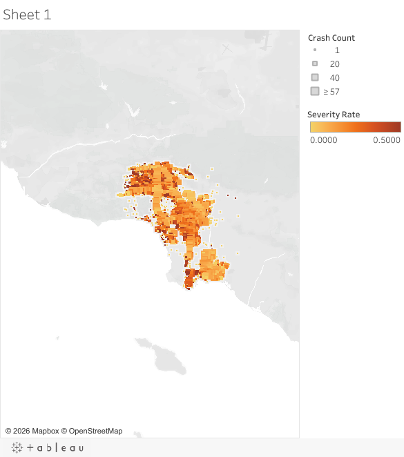
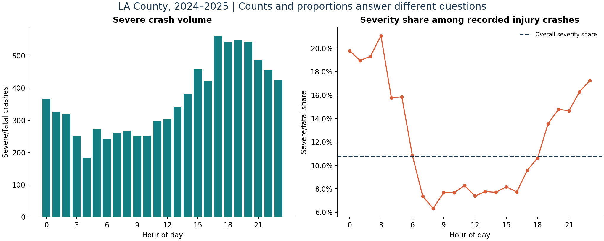

# Los Angeles Traffic Safety Analytics

**Turning crash records into a clear picture of when and where severe outcomes concentrate.**

Python · pandas · scikit-learn · Tableau | Collaborative STAT 544 project

**[Explore the Tableau dashboard](https://public.tableau.com/app/profile/kyubin.im/viz/Book1_17766647170630/Sheet1)** · **[Follow the analysis](analysis.ipynb)** · **[Five-minute walkthrough](WALKTHROUGH.md)**

[](https://public.tableau.com/app/profile/kyubin.im/viz/Book1_17766647170630/Sheet1)

## The project in four steps

| Step | What it demonstrates | Where to look |
| --- | --- | --- |
| **1. Clean and manage** | Choose a consistent data snapshot, preserve one row per crash, validate times, and handle missing coordinates. | [Cleaning decisions](data/README.md) |
| **2. Explore** | Compare crash counts with severity shares to explain temporal and geographic patterns. | [Notebook, section 2](analysis.ipynb) |
| **3. Model** | Evaluate one random forest with a chronological holdout and metrics suited to class imbalance. | [Notebook, section 3](analysis.ipynb) |
| **4. Communicate** | Make observed patterns explorable through geographic bins and Tableau controls. | [Dashboard guide and workbook](dashboard/README.md) |

## Three findings to remember

- **8,774 of 81,261 recorded injury/fatal crashes were severe or fatal: 10.80%.**
- **Late Night (00:00–04:59) had a 19.08% severe share**, compared with **7.75% at Midday (10:00–14:59)**. Night (19:00–23:59) had the largest severe count of the five time blocks.
- **Los Angeles, unincorporated areas, and Long Beach** had the highest severe-crash counts: **3,992, 1,211, and 435**.



These results describe recorded injury/fatal crashes. They do not measure risk per journey or demonstrate that changing patrol coverage reduces fatalities.

## One modeling process

The existing random forest classifies severe/fatal versus other injury crashes. It uses **64,945 earlier crashes for training** and **16,237 later crashes for testing**, with balanced class weights and a fixed random seed.

Held-out **ROC AUC: 0.627**; **PR AUC: 0.156**. At threshold 0.50, severe-class precision is **16.95%** and recall is **31.91%**. The takeaway is a transparent evaluation process and a candid assessment of modest predictive value. Some inputs are recorded after a crash, so this is a retrospective severity analysis. The dashboard displays observed crashes and severity shares.

## Simple structure

```text
analysis.ipynb    One walkthrough: cleaning → EDA → model → Tableau
WALKTHROUGH.md   A five-minute presentation script
data/            Cleaning decisions and snapshot provenance
src/             clean.py, eda.py, model.py
dashboard/       Tableau dashboard link, preview, and guide
results/         Key figures and model metrics
tests/           Checks on data quality and transformations
run.py           Reproduce the complete workflow
```

## Run it

Use **Python 3.12**. Data files are not published in this repository; download the Los Angeles County crash records from [TIMS](https://tims.berkeley.edu/) and save them as `data/crashes_2024_2025.csv.gz`, or pass the file with `python run.py --data "path/to/Crashes_sorted.csv"`. See [data/README.md](data/README.md).

```bash
python -m venv .venv
source .venv/bin/activate       # Windows PowerShell: .venv\Scripts\Activate.ps1
python -m pip install -r requirements.txt
python run.py
```

Generated results and the Tableau CSV go to `outputs/`. The reviewed figures and metrics are in `results/`. Open `analysis.ipynb` in VS Code or Jupyter using the same environment to follow each step. Checks: `python -m unittest discover -s tests -v`.

## Source

Data: California Highway Patrol SWITRS via **Transportation Injury Mapping System (TIMS), Safe Transportation Research and Education Center, University of California, Berkeley**. [Source and terms](https://tims.berkeley.edu/about.php#terms) · [Snapshot provenance](data/manifest.json). Source data and basemap credits retain their original terms; no blanket reuse license is assigned here.
